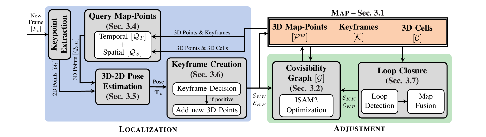

.. Copyright (C) 2026 Mitsubishi Electric Research Laboratories (MERL)
.. SPDX-License-Identifier: AGPL-3.0-or-later

Code Structure
==============

This page summarizes the SLAM-MER architecture following Section 3 of
``Revisiting Monocular SLAM with Spatio-Temporal Scene Modeling``.

SLAM-MER Pipeline
-----------------

The figure below illustrates the pipeline:

Pipeline figure from Section 3 (Figure 2) of
``Revisiting Monocular SLAM with Spatio-Temporal Scene Modeling``.

The system is organized around:

- A map representation
- A covisibility graph
- A localization front end, a covisibility-graph back end, and optional loop
  detection

Map Representation
------------------

Given an input stream of monocular frames, the map is built online as:

- ``K``: keyframes
- ``P^w``: 3D map-points in world coordinates
- ``C``: 3D cells grouping map-points spatially

Each keyframe stores:

- A camera pose, with optional Sim(3)-style scale handling in graph
  optimization
- 2D keypoints and descriptors
- Local 3D points (from depth inference when a keyframe is created)

Each map-point stores:

- A 3D world position
- Descriptors from observing keyframes
- Observation relations with keyframes

The 3D cells support efficient spatial queries by grouping nearby map-points.

Covisibility Graph
------------------

The covisibility graph contains nodes and constraints over keyframes and
map-points:

- Keyframe-keyframe edges: relative-pose constraints
- Keyframe-point edges: 3D-2D projection and 3D-3D local-to-world distance
  constraints

This graph is the core structure used by the optimization back-end.

Pipeline Workflow
-----------------

The localization front end runs for each incoming frame. Keyframe creation can
run asynchronously for monocular frames, while the covisibility graph runs
background edge-insertion and optimization threads. When visual place
localization is enabled, loop detection also runs in a background thread.

Localization Module
^^^^^^^^^^^^^^^^^^^

For each incoming frame:

1. Extract 2D keypoints and descriptors.
2. Query map-points (temporal + spatial).
3. Build 3D-2D correspondences.
4. Estimate absolute pose.
5. Decide whether to create a new keyframe.

When a keyframe is created, local 3D points from RGB-D input or depth inference
are added to the map and corresponding graph constraints are inserted.

For monocular input, depth inference is requested during keyframe creation, not
for every frame. The current implementation gathers the current image plus a
small set of recent frames or keyframes for the depth-inference call.

Adjustment Module
^^^^^^^^^^^^^^^^^

The adjustment module consumes queued observation and odometry edges and
incrementally optimizes keyframe poses and map-point positions using a
factor-graph back end (ISAM2/GTSAM). In ``SLAM`` and ``SLAM_WITHOUT_LOOP``
modes, a background optimization thread updates the map from the graph.

Loop closure constraints are also fused through this same graph update flow.

Modular Design
^^^^^^^^^^^^^^

The pipeline is modular by construction:

- 2D feature extractors and descriptors can be replaced
- Depth inference models can be replaced
- Image retrieval methods can be replaced
- The same workflow can be adapted to RGB-D inputs

Query Map-points
----------------

SLAM-MER queries map-points using two complementary strategies:

- Temporal query (``Q_T``): map-points linked to keyframes associated with the
  last localized frames in the buffer
- Spatial query (``Q_S``): map-points from closest visible 3D cells to the
  current camera pose

The final query set is:

- ``Q_3D = Q_T union Q_S``

Descriptors from ``Q_3D`` are matched against current frame descriptors to
obtain robust 3D-2D correspondences.

Pose Estimation
---------------

Pose estimation is performed from 3D-2D correspondences with robust outlier
rejection (RANSAC). During early frames, focal length is estimated jointly
with pose; after stabilization, the focal value is fixed from the running
estimate to speed up processing.

Keyframe Creation
-----------------

A new keyframe is created when one or more of the following criteria is met:

- Too few tracked points after pose estimation
- Poor spatial spread of tracked/inlier keypoints in the image
- Significant change in tracked-map-point distribution across keyframes
  after the configured minimum spacing between keyframes

The third criterion is measured by comparing consecutive histograms of tracked
points over keyframes (KL-divergence), helping trigger keyframes when loops are
being formed.

Loop Closure
------------

Loop closure has two stages:

- Loop detection retrieves candidate keyframes with image-level descriptors and
  validates candidates geometrically with pose estimation
- Map fusion adds loop constraints to the graph and merges duplicated
  map-points when correspondences indicate the same scene structure

No special standalone optimization stage is required; the continuous graph
adjustment thread handles the update.

Relocalization
--------------

When localization fails for buffered frames (for example, after long occlusion
or kidnapping), relocalization is triggered:

1. Compute image-level descriptor for the current frame.
2. Retrieve similar keyframe candidates.
3. Validate candidates with geometric pose estimation.

After a valid relocalization, a new keyframe is created and normal localization
continues.

Dense Reconstruction
--------------------

Although the map representation is sparse (keyframes plus sparse map-points),
dense reconstruction can be generated from keyframe-local 3D predictions and
their optimized poses.
